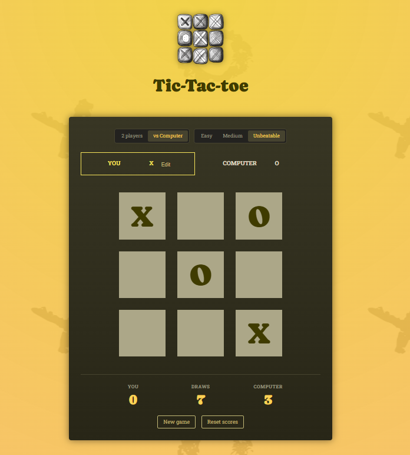

# Tic-Tac-Toe

[](https://github.com/gastonkitambala/tic-tac-toe/actions/workflows/ci.yml)

A React tic-tac-toe game with an unbeatable computer opponent, saved games and per-mode scoreboards.

**Live demo:** _coming soon_



## Features

- **Play a friend or the computer.** The computer has three levels: Easy, Medium and Unbeatable.
- **Unbeatable AI.** Minimax with alpha-beta pruning. A test plays every possible game against it, as X and as O, and checks that it never loses.
- **Nothing lost on reload.** The game in progress, player names, settings and scores are saved in `localStorage` and synced across open tabs.
- **Corrupted saves can't break the app.** A saved game is replayed move by move and thrown away if any move is illegal.
- **Separate scoreboards** for 2-player games and for each difficulty.
- Accessible controls: keyboard-friendly mode switches and labelled board squares for screen readers.

## Tech stack

React 19 · Vite 8 · Vitest 5 + React Testing Library · ESLint 10 · GitHub Actions · Vercel

## How it works

The game rules live in plain JavaScript modules with no React code, so they can be tested on their own:

| Module | Responsibility |
| --- | --- |
| [`src/game/engine.js`](src/game/engine.js) | Board state, win and draw detection for any N×N board, move validation, history validation |
| [`src/game/ai.js`](src/game/ai.js) | `chooseMove(board, symbol, difficulty)`: random, rule-based and minimax strategies |
| [`src/hooks/usePersistentState.js`](src/hooks/usePersistentState.js) | `useState` saved to `localStorage`, with versioned keys, validation and cross-tab sync |
| [`src/App.jsx`](src/App.jsx) | Works out the board and status from the move list, and runs the computer's turns |

The app stores only the list of moves. The board, the current player and the winner are all worked out from it on each render, so they can't get out of step with each other.

### The AI

| Level | Strategy |
| --- | --- |
| Easy | Random empty square |
| Medium | Win if possible → block the opponent → take the center → random |
| Unbeatable | Minimax with alpha-beta pruning. Scores are weighted by depth, so it wins as fast as possible and loses as slowly as possible. It picks randomly between equally good moves so games don't repeat. |

## Getting started

Requires Node.js 22.12 or later (see [`.nvmrc`](.nvmrc)).

```bash
npm install
npm run dev      # start the dev server
npm test         # run the test suite
npm run lint     # lint
npm run build    # production build in dist/
```

## Background

This project started as an exercise from a React course. I've since rebuilt it with a separate game engine, an AI opponent, persistence, tests and CI.
